# VIGILENS
### Visual Monitoring for Driver Alertness

**A Real-Time Webcam-Based Driver Alertness Monitoring and Drowsiness Detection Application Using Computer Vision**

VIGILENS is an educational Python desktop application that uses a webcam and classical computer-vision techniques to monitor visible facial indicators associated with possible driver drowsiness. It detects faces using OpenCV's Haar Cascade Classifier, identifies facial landmarks using dlib's 68-point facial landmark predictor, and calculates the Eye Aspect Ratio (EAR) and Mouth Aspect Ratio (MAR) to monitor eye closure and sustained mouth opening.

The application provides real-time monitoring, visual and audio alerts, session recording, detection history, and analytics through a desktop graphical interface.

> **Safety Notice:** VIGILENS is an educational prototype and is not a medical diagnostic tool or certified driver-safety system. It cannot guarantee driver alertness or prevent accidents. It must not replace adequate rest, responsible driving, or professional safety systems.

---

## 1. Features

- **Real-Time Webcam Monitoring** – Captures and processes webcam frames to monitor visible facial indicators.
- **Face Detection** – Uses OpenCV Haar Cascade Classifier to detect the face.
- **Facial Landmark Detection** – Uses dlib's pretrained 68-point facial landmark predictor to identify facial feature positions.
- **Eye Aspect Ratio (EAR)** – Measures eye openness to identify possible eye closure.
- **Mouth Aspect Ratio (MAR)** – Measures mouth opening to identify possible yawning.
- **Time-Based Drowsiness Detection** – Monitors prolonged eye closure before generating a drowsiness alert.
- **Visual and Audio Alerts** – Displays detection statuses and provides optional audio notifications.
- **Session Recording** – Saves monitoring sessions, detection events, and EAR measurements in a local database.
- **Session History** – Allows users to review completed monitoring sessions and their recorded events.
- **Analytics** – Presents session statistics, recorded events, and EAR measurements over time.
- **Configurable Settings** – Allows users to adjust detection thresholds, eye-closure duration, camera index, and audio preferences.

## 2. Computer Vision Topics Implemented

VIGILENS implements four computer-vision topics using Python and classical computer-vision techniques.

### 2.1 Image Operations

Image operations are applied to webcam frames during preprocessing and visualization.

Implemented operations include:
- Image resizing to manage frame dimensions and processing.
- Grayscale conversion for face detection.
- Histogram equalization to improve image contrast.
- Image flipping, annotations, and overlays for displaying monitoring results.

### 2.2 Haar Cascade Classifier

The application uses OpenCV's Haar Cascade Classifier for face detection.

The classifier processes grayscale webcam frames to locate visible faces. When multiple face regions are detected, the application selects the largest detected face for subsequent facial landmark analysis.

### 2.3 Image Analysis and Transformation

VIGILENS analyzes facial measurements using geometric calculations and NumPy.

**Eye Aspect Ratio (EAR)**

EAR estimates eye openness using distances between selected eye landmarks. Lower EAR values indicate possible eye closure.

**Mouth Aspect Ratio (MAR)**

MAR estimates mouth opening using selected mouth landmarks. Higher MAR values indicate sustained mouth opening that may be associated with yawning.

The application also monitors eye-closure duration to determine whether the configured condition for a drowsiness alert has been reached.

### 2.4 Facial Landmark Detection

The application uses dlib's pretrained 68-point facial landmark predictor.

The predictor identifies facial landmark positions around the eyes, eyebrows, nose, and mouth. These coordinates are used to calculate EAR and MAR.

**Note:** Image segmentation and motion/object tracking are not implemented features of this project.

## 3. How the Application Works

The VIGILENS monitoring process follows these steps:

1. **Webcam Capture** – Captures video frames from the selected webcam.
2. **Image Preprocessing** – Resizes and converts frames to grayscale for face detection.
3. **Face Detection** – Uses Haar Cascade to identify the face region.
4. **Facial Landmark Detection** – Uses dlib to estimate 68 facial landmark positions.
5. **Measurement Calculation** – Calculates EAR and MAR using the detected landmarks.
6. **Drowsiness Monitoring** – Evaluates eye-closure measurements over time using a smoothing process.
7. **Alert Generation** – Generates a drowsiness alert when the configured eye-closure condition is met.
8. **Event and Session Recording** – Saves monitoring information and detection events in the local SQLite database.

Possible yawning events are recorded as a secondary indicator. Yawning does not independently trigger a drowsiness alert.

## 4. Detection Parameters

The application uses configurable threshold values to evaluate facial measurements.

| Parameter | Default Value | Description |
|---|---:|---|
| EAR Threshold | 0.21 | Values below this threshold indicate possible eye closure. |
| MAR Threshold | 0.60 | Values above this threshold indicate sustained mouth opening. |
| Eye-Closure Duration | 2.0 seconds | Required eye-closure duration before a drowsiness alert is triggered. |
| Yawn Duration | 1.0 second | Required sustained mouth-opening duration for a possible yawn event. |
| Smoothing Window | 3 measurements | Number of measurements used to smooth detection values. |

These are configurable starting values, not universal measurements. Users can manually adjust the EAR and MAR thresholds and other available settings through the application.

## 5. Technology Stack

| Technology | Purpose |
|---|---|
| Python | Main programming language |
| OpenCV | Image processing and Haar Cascade face detection |
| dlib | Facial landmark detection |
| NumPy | Numerical and geometric calculations |
| CustomTkinter | Desktop graphical user interface |
| Tkinter | Supporting GUI components |
| Pillow | Image handling and webcam preview |
| Matplotlib | Analytics charts |
| SQLite | Local database storage |
| pygame | Audio alert playback |
| pytest | Automated testing |

## 6. System Requirements

- Windows 10 or Windows 11 recommended.
- Python 3.11 recommended.
- A working webcam.
- Speakers or headphones recommended for audio alerts.
- Sufficient storage for the application, dependencies, and facial landmark model.
- Internet connection for initial dependency and model downloads.

## 7. Installation and Setup

### 7.1 Clone the Repository

Open PowerShell or the VS Code terminal and run:

```powershell
git clone https://github.com/elainemaebalbada/VIGILENS.git
```

Navigate to the project folder:

```powershell
cd VIGILENS
```

### 7.2 Create a Virtual Environment

```powershell
py -3.11 -m venv .venv
```

### 7.3 Activate the Virtual Environment

```powershell
.\.venv\Scripts\Activate.ps1
```

If PowerShell blocks script execution, run:

```powershell
Set-ExecutionPolicy -Scope Process -ExecutionPolicy RemoteSigned
```

Then activate the virtual environment again.

### 7.4 Install Dependencies

Upgrade pip:

```powershell
python -m pip install --upgrade pip
```

Install the required packages:

```powershell
pip install -r requirements.txt
```

### 7.5 dlib Installation Note

The dlib package may require CMake and Microsoft Visual C++ Build Tools when a compatible prebuilt package is unavailable on Windows.

If installation fails, install the required build tools and CMake, then retry the installation.

## 8. Facial Landmark Model Setup

VIGILENS requires dlib's pretrained 68-point facial landmark predictor:

`shape_predictor_68_face_landmarks.dat`

**The model file is not included in this GitHub repository because of its large file size. It must be downloaded and placed in the project folder before running the application.**

### Step 1: Download the Model

Download the compressed model from the official dlib files page:

[Download the 68-point facial landmark predictor (.bz2)](http://dlib.net/files/shape_predictor_68_face_landmarks.dat.bz2)

### Step 2: Extract the File

The downloaded file is compressed in `.bz2` format. Extract it using an archive utility such as 7-Zip.

The extracted file must be named:

`shape_predictor_68_face_landmarks.dat`

### Step 3: Create the Models Folder

Inside the main VIGILENS project directory, create a folder named `models`.

Place the extracted `.dat` file inside it.

The final directory should look like this:

```text
VIGILENS/
└── models/
    └── shape_predictor_68_face_landmarks.dat
```

**Important:** Make sure the extracted `.dat` file is inside the `models` folder. The compressed `.bz2` file alone is not sufficient for the application.

## 9. Running the Application

After completing the installation and model setup, make sure the virtual environment is activated.

From the main VIGILENS project directory, run:

```powershell
python main.py
```

The VIGILENS desktop application will launch.

The application automatically creates its local SQLite database when needed. The database is stored at:

```text
data/
└── vigilens.db
```

The database stores application settings, monitoring sessions, detection events, and periodic EAR measurements.

## 10. Using VIGILENS

1. Launch the application using `python main.py`.
2. Open **Settings** to review the camera index, detection thresholds, and audio preferences.
3. Navigate to **Live Monitoring**.
4. Click **Start Monitoring** to initialize the webcam and detection process.
5. Position your face within the camera view and ensure adequate lighting.
6. Observe the displayed facial measurements and monitoring status.
7. Click **Stop Monitoring** to end the session and save its recorded information.
8. Open **Session History** to review completed sessions and their recorded events.
9. Open **Analytics** to review session statistics and measurement charts.

## 11. Application Pages

| Page | Description |
|---|---|
| Dashboard | Displays system status, completed-session statistics, recorded events, and the latest completed session. |
| Live Monitoring | Displays the webcam preview, facial measurements, eye status, monitoring status, and alerts. |
| Session History | Displays completed monitoring sessions and their recorded detection events. |
| Analytics | Presents session summaries, event statistics, and EAR trend charts. |
| Settings | Allows users to configure detection thresholds, camera index, and audio preferences. |
| About | Provides the project overview, objectives, computer-vision topics, technology stack, instructions, and limitations. |

## 12. Database and Session Management

VIGILENS uses SQLite for local data storage.

The database maintains:
- Monitoring session records.
- Drowsiness alert and possible yawning events.
- Periodic EAR measurements.
- Application settings.

Only completed sessions are included in the completed-session statistics.

Session IDs are automatically generated by SQLite. Therefore, session IDs may not match the total number of currently stored sessions, particularly when records have been deleted.

The database is stored locally and is not automatically synchronized with an external server.

## 13. Testing

The project includes automated tests for its supporting components.

To run the tests, execute:

```powershell
pytest -v
```

The tests cover:
- EAR calculations.
- MAR calculations.
- Drowsiness detection logic.
- Database operations.
- Session management.
- Monitoring service behavior.
- Settings validation.
- Alert service behavior.
- UI structure.

Automated tests do not replace testing with an actual webcam, the facial landmark model, and audio hardware.

## 14. Known Limitations

VIGILENS is an educational computer-vision prototype and has the following limitations:

- Detection performance may be affected by poor lighting conditions.
- Glasses, reflections, and facial occlusion may affect landmark detection.
- Head rotation and camera positioning may reduce detection reliability.
- Webcam quality and individual facial differences may affect measurements.
- The application is designed for single-face monitoring.
- Yawning is treated as a secondary indicator and does not independently trigger a drowsiness alert.
- EAR and MAR measurements do not establish a medical diagnosis.
- The system cannot guarantee driver alertness or prevent accidents.

## 15. Privacy

VIGILENS stores session summaries, detection events, application settings, and periodic EAR measurements in a local SQLite database.

The application does not intentionally save webcam video recordings or facial photographs.

Users are responsible for protecting their local project folder and database files.

## 16. Application Screenshots

The following screenshots demonstrate the main interface and monitoring functions of VIGILENS.

### Dashboard

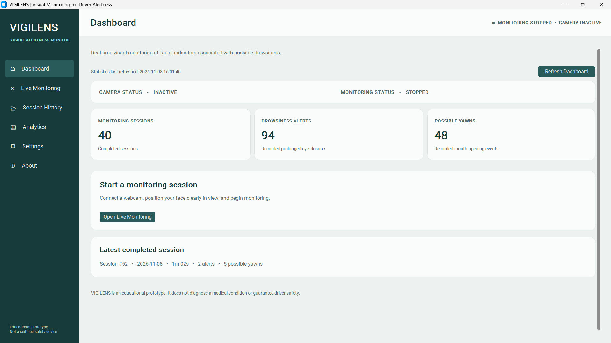

### Live Monitoring

**Normal Status**

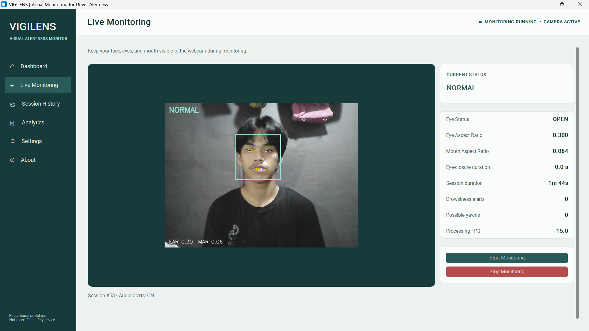

**Eyes Closed Status**

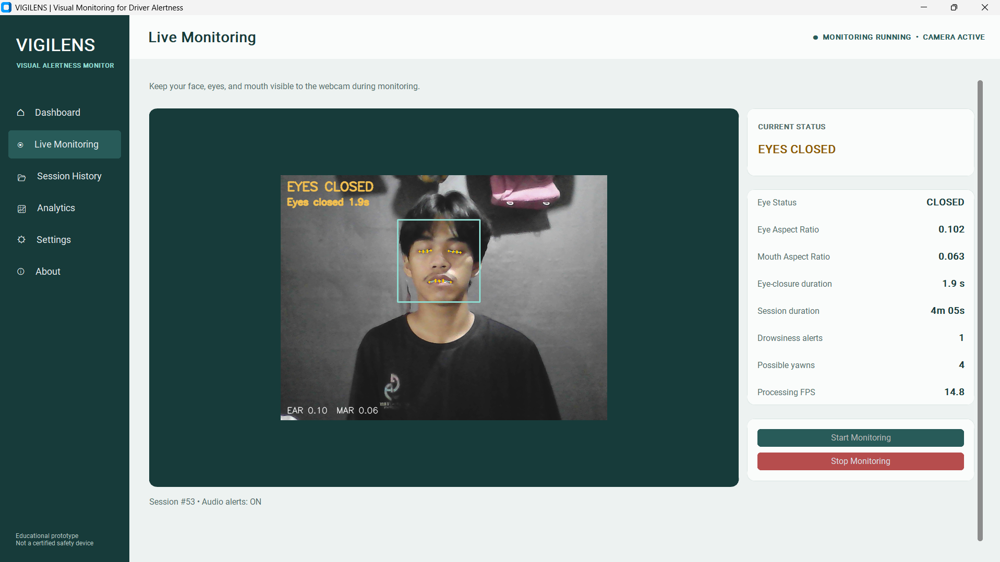

**Yawning Status**

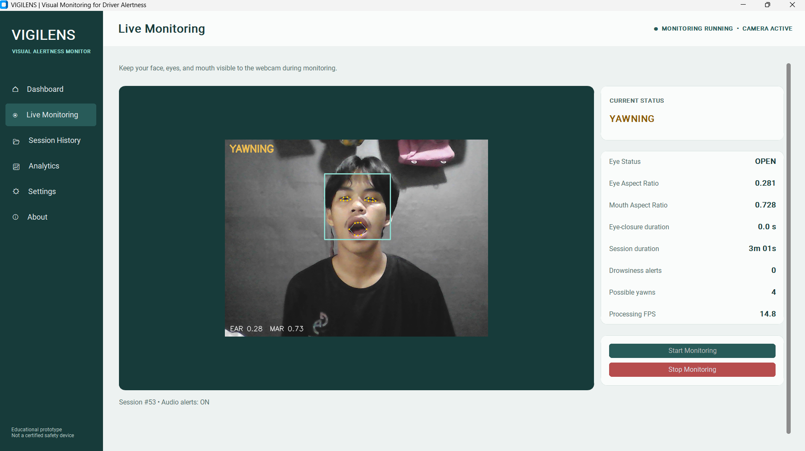

**Drowsiness Alert**

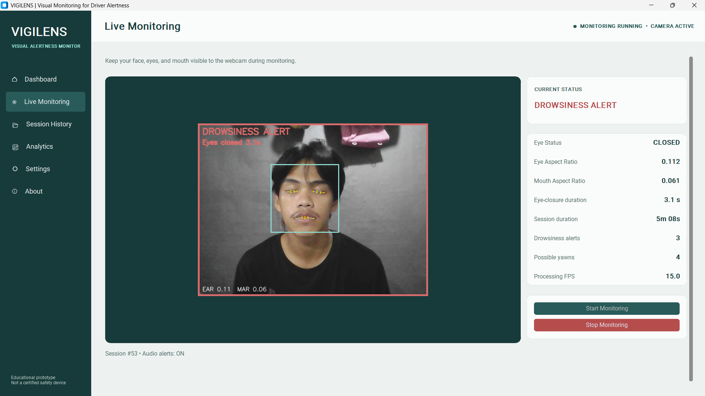

### Session History

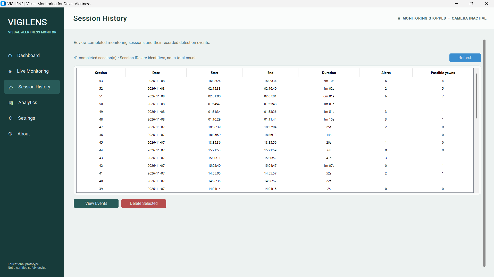

**View Session Events – Session #53**

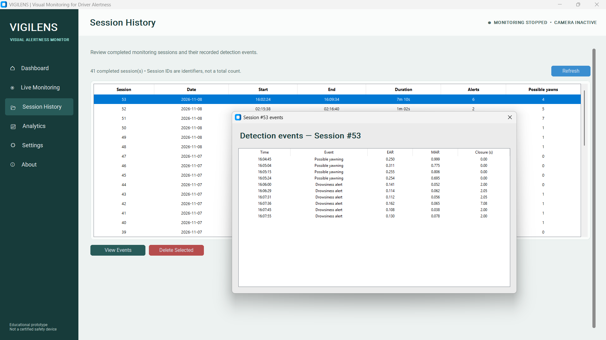

### Analytics

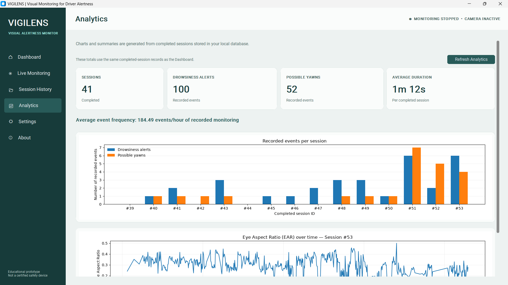

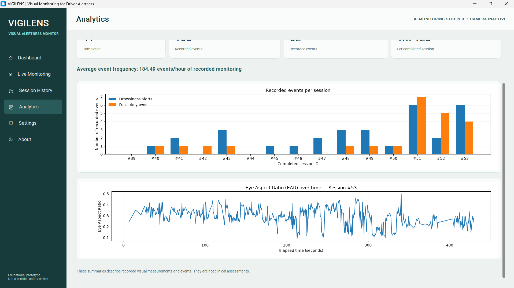

### Settings

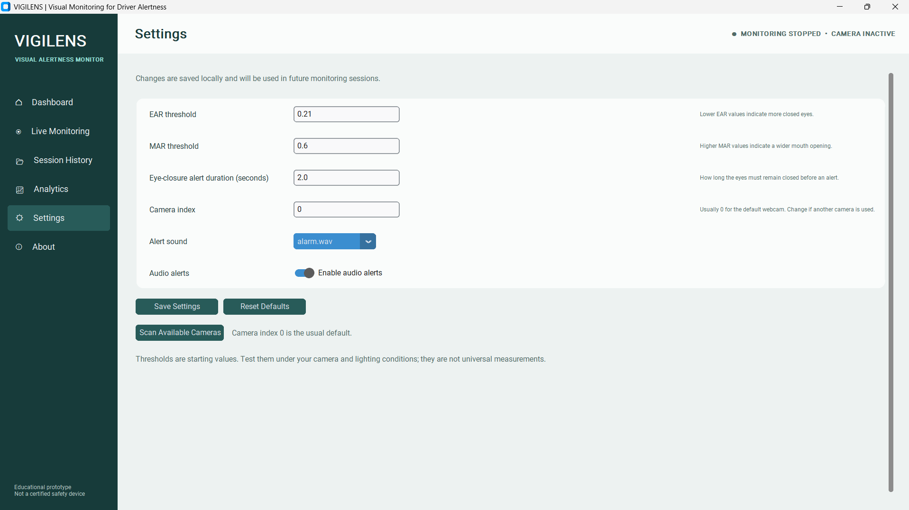

### About

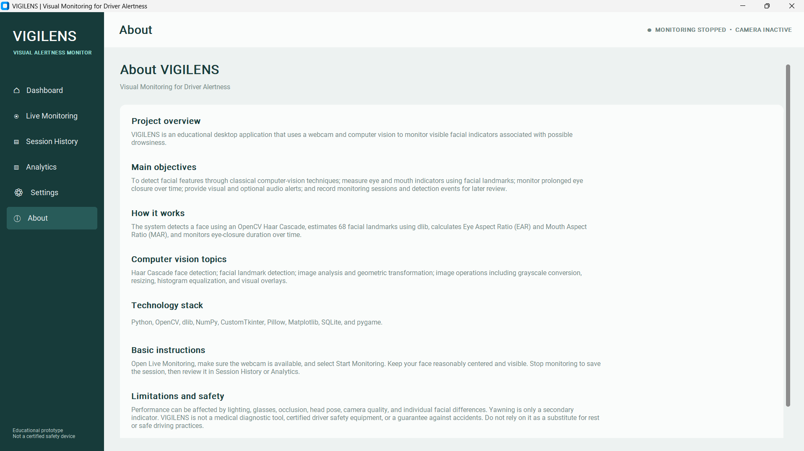

---

**VIGILENS – Visual Monitoring for Driver Alertness**

Educational Computer Vision Project | CSC 126

Developed by:

- Balbada, Elaine Mae M.
- Calderon, Kiesha Jae T.
- Manatad Jr., Peter Paul S.
